# Run Instructions (MacOS)

Clone this repo from GitHub
```bash
git clone https://github.com/CB12354/ds3022-dp2-kqe6rf
```

Create a virtual environment and activate it in the root folder 
```bash 
python -m venv .venv
source .venv/bin/activate
```
Install requirements  
```bash
pip install -r requirements.txt
```
Add a .env file with these variables in the root folder:
```
UVA_ID=ADD YOUR SCHOOL COMPUTING ID HERE

# This endpoint URL points to a locally hosted server.
# You can configure it to host it on a remote server, such as AWS.
AWS_ENDPOINT_URL_SQS=http://127.0.0.1:9324
AWS_DEFAULT_REGION=us-east-1
AWS_ACCESS_KEY_ID=test
AWS_SECRET_ACCESS_KEY=test

# Scatter API (kit/scatter_api.py) port
SCATTER_PORT=8000
# Adjust message send delays for development's sake. 1 is faster.
DP2_FAST=1

# DuckDB file name shared by your flow and dbt (relative to the repo root)
DP2_DUCKDB=dp2.duckdb

# Adjust sent messages to include duplicates or malformed messages. 1 is bad messages enabled.
DP2_CHAOS=1
```

Run the moto server, port should match the API endpoint:  
```bash
moto_server -p 9324
```

Run the scatter API server:  
```bash
python kit/scatter_api.py
```
Make sure scatter is restarted after any edits to .env

Run the prefect dashboard:  
```bash
prefect config set PREFECT_API_URL="http://127.0.0.1:4200/api"
prefect server start
```
Run the project:  
```bash
python prefect-flow.py
```

Check to see if the submission is valid with:
```bash
python kit/check_submission.py
```

# Project Information

### Polling Strategy  
This system uses long polling. It repeatedly queries the queue for visible messages for up to 10 seconds until one is visible, up to a max of 10 messages each poll:

```python
resp = sqs.receive_message(QueueUrl=queue_url,
                    MaxNumberOfMessages=10,
                    MessageAttributeNames=["All"],
                    WaitTimeSeconds=10)
```

Long polling has the second lowest API overhead compared to counter and sleep polling, and the time was comparable to counter polling. The stop rule was decently easy to implement (guardrails for duplicates, poisoned messages and a stop rule of 21 valid messages), so I chose long polling as my strategy. Hard-coded delay polling was far slower, and runtimes can be very long, so that option was ignored.

### Receipt Code:
PASS  kqe6rf / prefect  receipt: CE225D6900

### Receive-save-delete
Messages are received and saved first due to problems with lost data if the computer crashes. If the message is deleted before it is saved, then an unlucky power-off could lose that message permanently. When doing a task like assembling ordered data, losing something in between could lose context for the later data, breaking the flow entirely. If the crash happens with saving first, then the message remains visible and is added on the next iteration as a duplicate. However, SELECT DISTINCT in the dbt gate deals with duplicates effectively, so this cost is negligible compared to a lost message. In addition, a restarted flow replaces the existing table and repopulates the queue, so entries are started fresh.

### Idempotency
A crashed flow may cause duplicate messages. There also may be duplicates simply due to random chance, as producers are *at least once* instead of *exactly once.* Idempotency is making sure that duplicate queries/messages are only processed once/yield the same result. The SQL deals with duplicates by selecting only the unique messages:
```sql
select distinct
    cast(order_no as integer) as order_no,   -- arrives as a string
    trim(word)                as word
from {{ source('raw', 'fragments') }}
```

### dbt tests
dbt tests ensure that the full sequence is present by using assert_complete_sequence.sql, as well as making sure that there are no missing values in the word or order number section, and no duplicate order numbers. These tests make sure that the processing after the data is loaded can go perfectly, by simply re-ordering the data fetched directly from the table.

### Purposes of each tool
- Prefect manages the execution of the workflow and allows retries of individual steps. It also allows more comprehensive logging, showing the steps of the flow graphically and text-based logging. By removing Prefect, the workflow might still work, but you'd have to use Python's logging library, and if something goes wrong, you'd have to start the entire process over from the very beginning.
- dbt (Data Build Tool) is the transform step of the pipeline. It more rigidly defines the structure of the tables it uses, but also allows custom tests on the data to ensure it follows certain rules, such as only unique values or that all values in an expected list are present. It also does the heavy lifting of transforming the data for later. For this workflow, it ensures the full list of words is present, and cuts duplicates with SELECT DISTINCT. It also assembles the phrase with its assembled_phrase.sql model. Cutting dbt could cause problems with idempotency or missing values, letting the flow continue without its necessary data or with too much data. Removal would force the phrase assembly to take place elsewhere as well.
- DuckDB is the data storage medium. It stores its values as tables, allowing SQL queries from other sources, such as the flow Python script, to add, read, alter and remove them. In this case, it stores the incoming messages, both their words and their order, in a table, for dbt to operate on later. You could not reasonably cut DuckDB from this project, as the other parts of the workflow are reliant on the data being stored this way. If you did, you'd need to rewrite the entire program to store it in a more volatile way, such as a DataFrame written to a CSV file.

### Chaos Round
- Changes: 2 duplicated messages and 1 broken message without the necessary attributes
- Broken: Before the modifications, the script explicitly searched for an order number as a string converted to an integer and a word with a proper string value. If either of those things doesn't exist, the workflow failed on the first message it didn't agree with. It also may register duplicated messages and allow them to pass through, making the word sequence miss one of its words if the stopping rule of "exactly 21" is used. Chaos mode actively tries to trip these hazards, sending a duplicate message and messages with unreadable data. 
- Fixes: These issues were fixed by adding a catch function that parses messages for validity before inserting them. If it fails, they are inserted into a rejects table, then deleted. Duplication issues are solved at two stages: the first by counting only unique order numbers in the Python flow (stored_count()) and by using "SELECT DISTINCT" in the dbt step.

# Screenshots

DAG Sketch
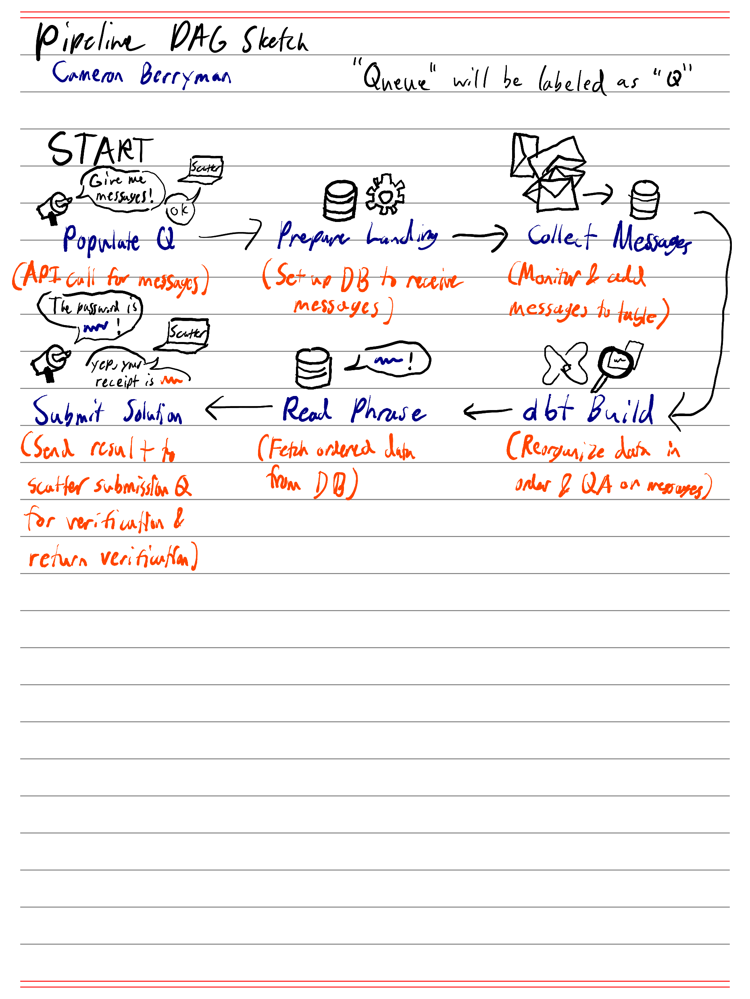

Dashboard screenshot at checkpoint A
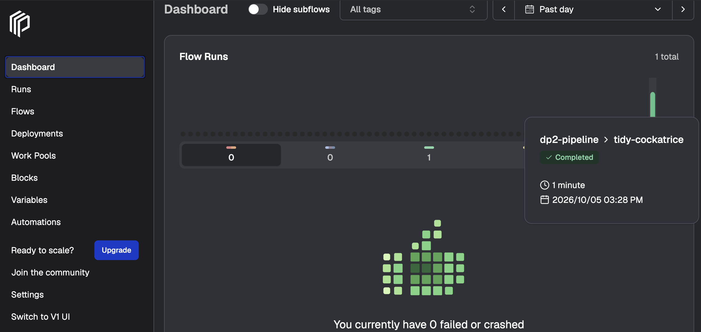

Proof there were 0 messages left at the end of the run
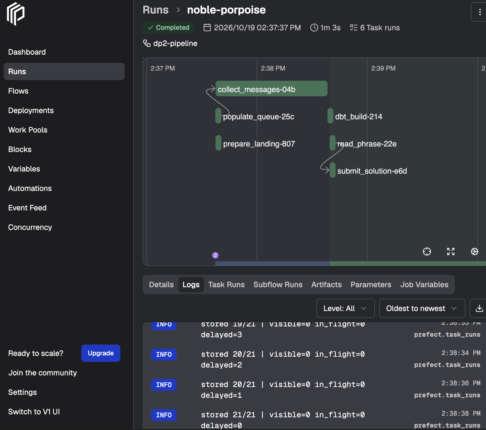

Proof I did 2 chaos mode runs that succeeded in a row
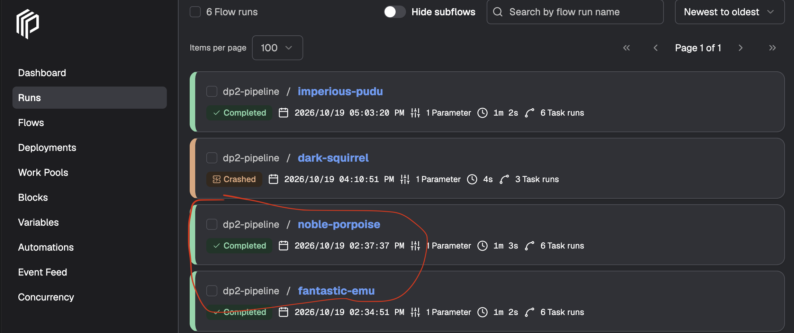
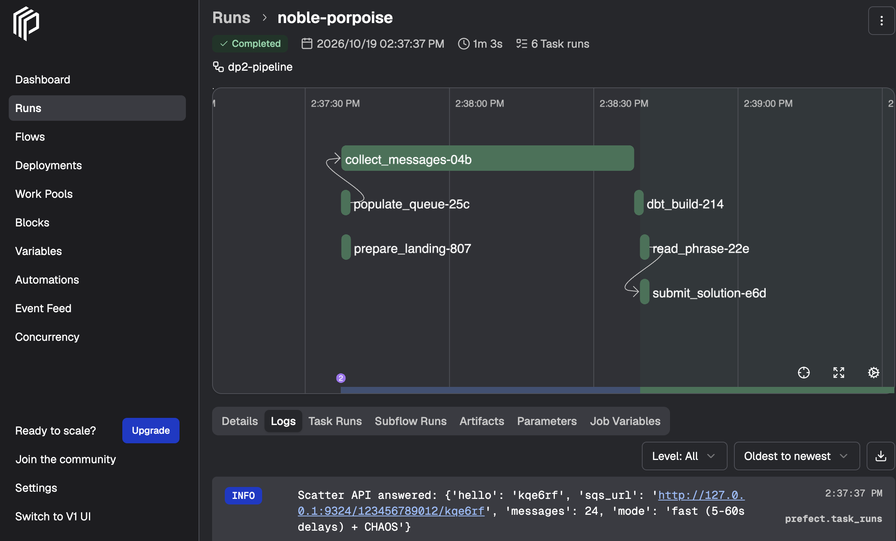
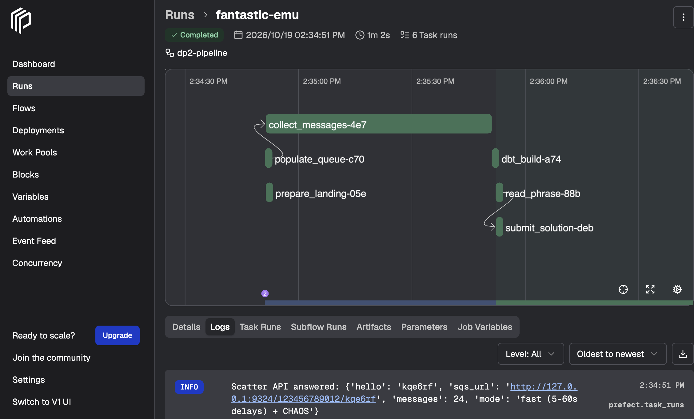

Test fail (too few fragments)
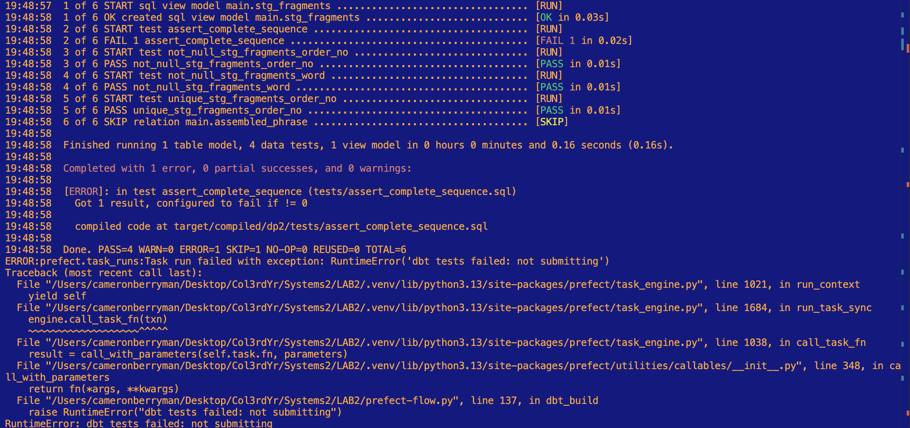

Test fail (too many fragments)
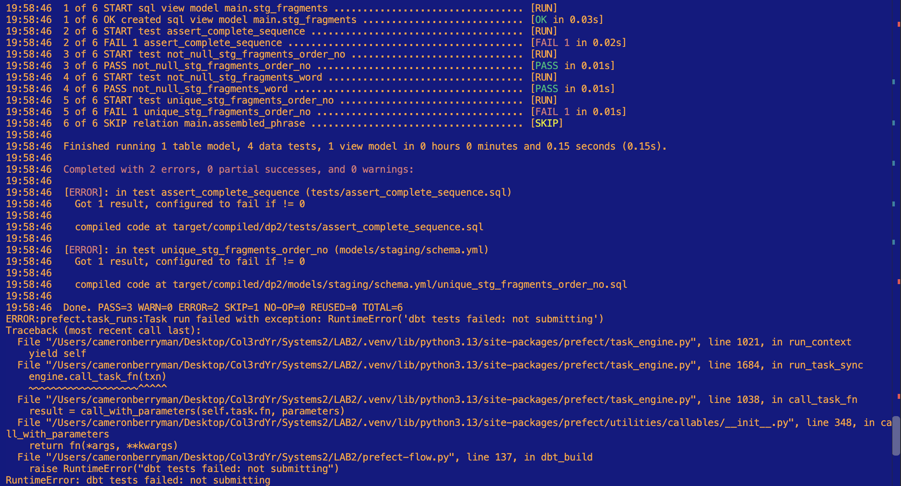
I left this test in the dbt_build() function as a comment:  
```python
#duckdb.connect(DUCKDB_PATH).execute("insert into raw.fragments select order_no, word||'X', received_at from raw.fragments where order_no='7'")
```

Tests passed
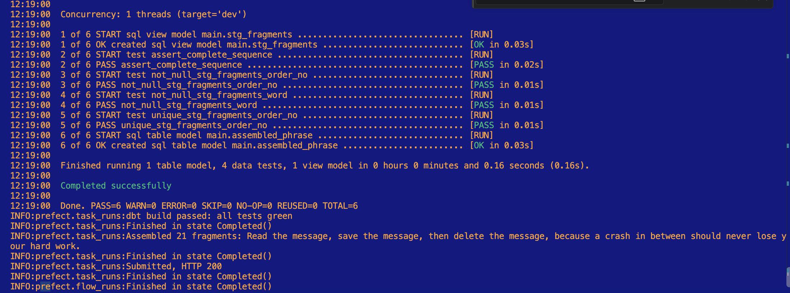

Dashboard screenshot at checkpoint F with long runtime:
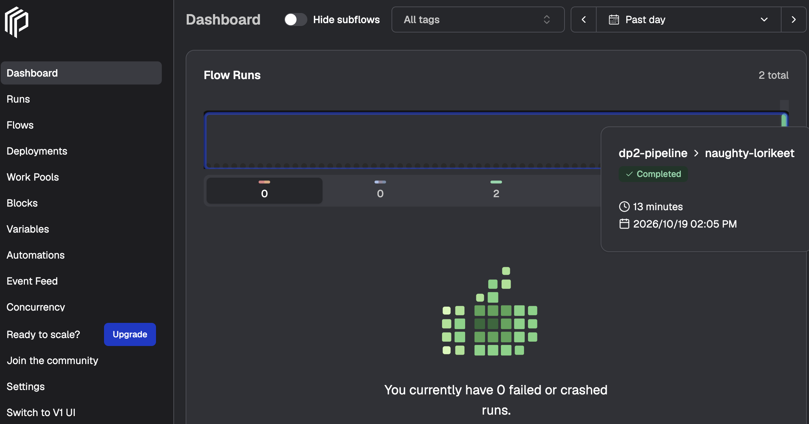

Dashboard run to prove this run had the long timing parameter active:
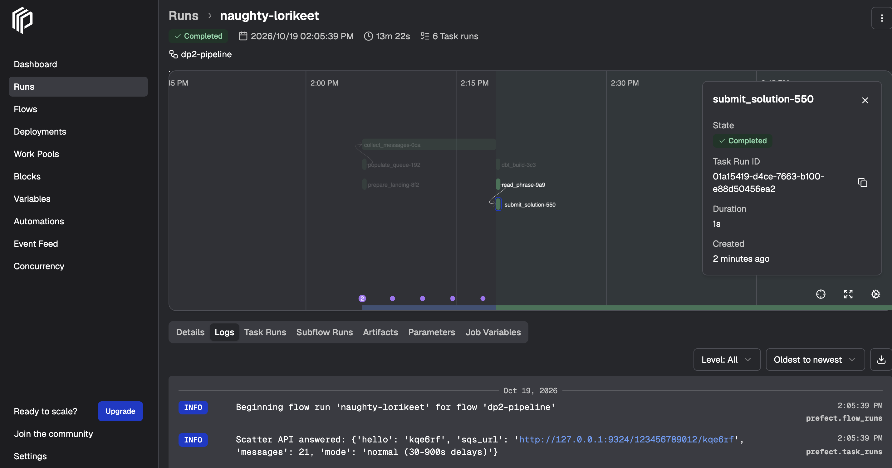

